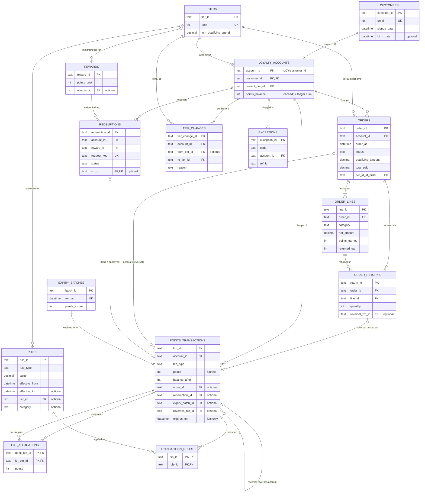

# Data model

15 tables: the 10 core entities from the brief, plus 2 bridge tables for
many-to-many relationships and 3 event/history tables that keep state changes
as explicit records instead of overwriting them. Field-level detail is in
[data_dictionary.md](data_dictionary.md); the enforced DDL is
[`src/loyalty/schema.sql`](../src/loyalty/schema.sql).

| Kind | Tables |
|---|---|
| Core entities (brief) | `customers`, `loyalty_accounts`, `tiers`, `rules`, `orders`, `order_lines`, `points_transactions`, `rewards`, `redemptions`, `expiry_batches` |
| Bridge tables (N:M) | `lot_allocations` (debit transaction <-> accrual lot), `transaction_rules` (transaction <-> rule) |
| Event / history tables | `order_returns` (each return event), `tier_changes` (tier history), `exceptions` (operations queue) |
| Labels (separate folder) | `ground_truth` - never joined to the tables above |

## ER diagram

GitHub renders this diagram. Notation: `||` exactly one, `o|` zero or one,
`|{` one or more, `o{` zero or more.

## Relationships and cardinality

| Parent | Child (FK column) | Cardinality | Optional? | Notes |
|---|---|---|---|---|
| customers | loyalty_accounts.customer_id | 1 : 1 | no | `account_id = 'LOY-' + customer_id`; enforced by UNIQUE and CHECK |
| tiers | loyalty_accounts.current_tier_id | 1 : N | no | |
| tiers | rules.tier_id | 1 : N | yes | only `EARN_RATE` rules point to a tier |
| tiers | rewards.min_tier_id | 1 : N | yes | null = any tier may redeem |
| loyalty_accounts | orders.account_id | 1 : N | - | an account may have 0 orders |
| tiers | orders.tier_id_at_order | 1 : N | no | snapshot of the tier used for the earn rate |
| orders | order_lines.order_id | 1 : N | no | 1-4 lines per order; `(order_id, line_no)` unique |
| orders / order_lines | order_returns.order_id / line_id | 1 : N | no | a line can be returned in several partial returns; the line must belong to the order |
| points_transactions | order_returns.reversal_txn_id | 1 : 0..1 | yes | null when the line earned no points (e.g. gift card) |
| loyalty_accounts | points_transactions.account_id | 1 : N | no | the ledger |
| orders | points_transactions.order_id | 1 : 0..N | yes | at most one ACCRUAL per order, plus 0..N REVERSALs |
| points_transactions | points_transactions.reverses_txn_id | 1 : 0..N | yes | self-reference: a REVERSAL points to the ACCRUAL it undoes |
| loyalty_accounts / rewards | redemptions.account_id / reward_id | 1 : N | no | every attempt is recorded, approved or not |
| points_transactions | redemptions.txn_id | 1 : 0..1 | yes | set only when APPROVED; UNIQUE |
| redemptions | points_transactions.redemption_id | 1 : 0..1 | yes | the REDEMPTION debit row |
| expiry_batches | points_transactions.expiry_batch_id | 1 : N | yes | EXPIRY rows created by that monthly run |
| points_transactions | lot_allocations | **N : M** | - | bridge: which accrual lots paid for which debit (redemption, expiry, reversal) |
| points_transactions / rules | transaction_rules | **N : M** | - | bridge: which rules decided each transaction |
| loyalty_accounts | tier_changes.account_id | 1 : N | no | first row is always ENROLLED |
| tiers | tier_changes.from_tier_id / to_tier_id | 1 : N | from: yes | from is null only for ENROLLED |
| loyalty_accounts | exceptions.account_id | 1 : N | no | |

Two links are circular (a redemption references its ledger row and the
ledger row references the redemption; a reversal references another ledger
row). The SQL foreign keys are therefore `DEFERRABLE INITIALLY DEFERRED` and
checked at COMMIT.

## Lifecycle states

State changes are stored as new rows, never by overwriting history.

| Entity | States and transitions | Where the history lives |
|---|---|---|
| Order | `COMPLETED` -> `PARTIALLY_RETURNED` -> `RETURNED` (forward only) | `order_returns` rows + REVERSAL ledger rows |
| Redemption | request -> `APPROVED` (debit posted) or `REJECTED` (reason, no debit). Terminal; a retried `request_key` returns the original result | `redemptions` (one row per attempt) |
| Points lot (ACCRUAL / BONUS row) | open -> partly used -> fully used **or** expired (once) | `lot_allocations` rows against the lot |
| Tier | `ENROLLED` (Bronze) -> `UPGRADE` / `DOWNGRADE` steps; each step's `from` = previous `to` | `tier_changes` |
| Account balance | never stored as truth: always the sum of the ledger | `points_transactions.balance_after` |
| Account status | `ACTIVE` only (assumption: no closures in the simulated window) | - |

## Effective dates

| Field | Meaning |
|---|---|
| `tiers.effective_from` | tier definition valid from this date |
| `rules.effective_from` / `effective_to` | rule applies when `effective_from <= t < effective_to` (null `effective_to` = open-ended); e.g. the festive Electronics multiplier runs 2026-10-15 to 2026-11-15 |
| `points_transactions.expires_on` | lot expiry = earned time + `POINTS_EXPIRY` days (365) |
| `orders.tier_id_at_order` | tier in effect at the moment of purchase |

## Time convention

All timestamps are naive local times (assumed Asia/Kolkata, the program's
single market), stored as ISO-8601 `YYYY-MM-DD HH:MM:SS`. The simulated window
is 2026-01-01 to 2028-01-01.
